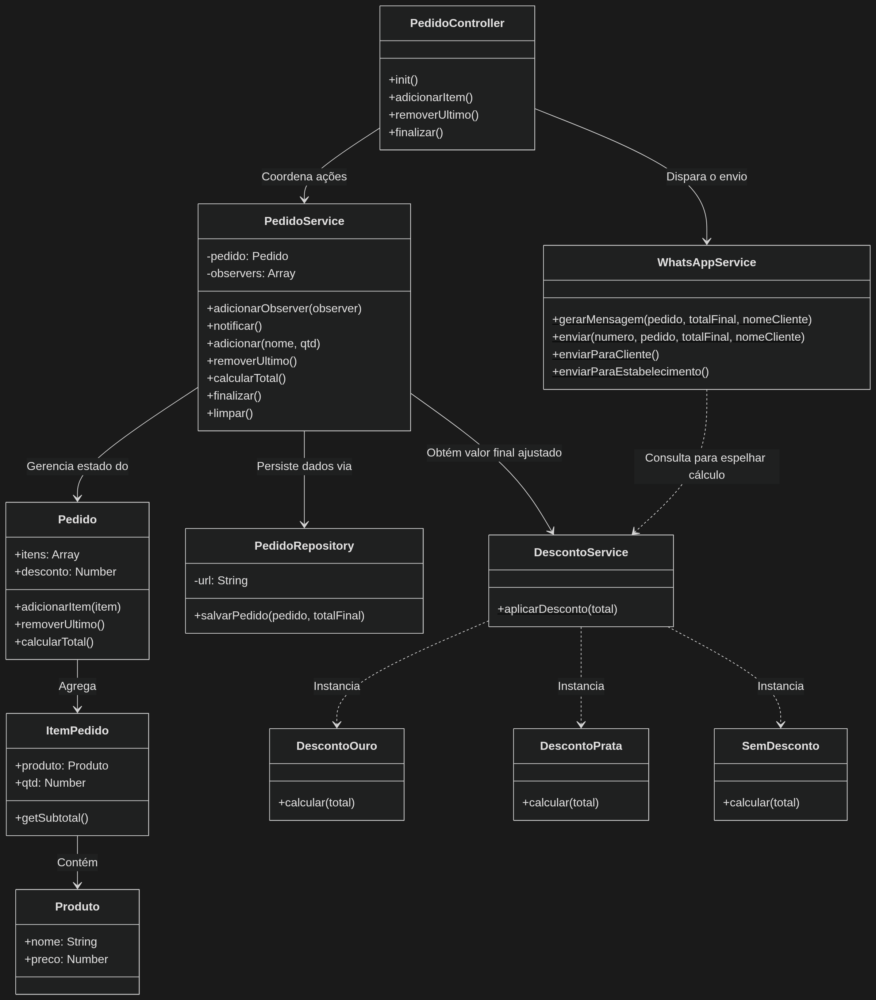

# Justificativa Arquitetural - Sistema de Pedidos Pastelaria Gourmet

Este documento apresenta a fundamentação teórica, as decisões de design de software e as respostas detalhadas aos critérios avaliativos exigidos na Prática Orientada 05.

---

## 📊 Diagrama de Classes (Arquitetura do Projeto)

O diagrama abaixo reflete a divisão estrutural exata das pastas do projeto e mapeia o fluxo exigido: View -> Controller -> Service -> Repository -> Model.

---

## 🧠 Análise Arquitetural (Respostas das Questões)

### 1. O MVC melhorou a organização?
Sim. O sistema saiu de um modelo confuso para uma estrutura com pastas e responsabilidades bem definidas. A interface gráfica (HTML/DOM) não se mistura mais com regras de cálculo ou persistência.

### 2. O sistema ficou mais desacoplado?
Sim. Com a introdução das Views isoladas e do padrão Observer, o core do sistema (as regras de negócio) não depende diretamente do DOM. As operações de dados foram isoladas em componentes específicos.

### 3. Onde ainda existem problemas?
O principal problema do MVC tradicional é que o Controller tende a se tornar um intermediário burocrático. Conforme novos fluxos visuais surgem, o Controller precisa crescer para repassar chamadas entre as Views e os Services.

### 4. O MVC seria suficiente para um sistema muito grande?
Não. Em sistemas de grande porte, o MVC puro entra em colapso, gerando o fenômeno dos Controllers Gordos (Massive View Controller), onde a centralização do fluxo em um único ponto inviabiliza o trabalho em paralelo e a manutenção.

### 5. Quais limitações você percebeu?
A rigidez do fluxo bidirecional. O Controller precisa conhecer a View e o Service ao mesmo tempo. Além disso, o MVC tradicional não prevê nativamente onde colocar integrações externas (como o WhatsApp).

### 6. Onde services ajudaram?
Os Services salvaram o Controller de carregar regras de negócio complexas. Eles limparam o código ao centralizar cálculos, validações e a aplicação do padrão Strategy.

### 7. Onde repositories ajudaram?
Os Repositories isolaram completamente as chamadas assíncronas de rede feitas para o JSON Server. Graças a eles, se a URL da API mudar, nenhuma linha do Controller ou do Service precisará ser alterada.

---

## ⚠️ Problemas do MVC Tradicional em Larga Escala

Se este sistema expandisse muito, o MVC puro traria as seguintes complicações:
* Controllers Gordos: O PedidoController acumularia funções excessivas, violando o princípio de Responsabilidade Única.
* Dificuldade de Manutenção: Rastrear bugs em fluxos gigantescos que cruzam várias camadas vira um desafio.
* Aumento do Acoplamento: Alterar a estrutura de uma View exigiria modificações em cascata no Controller.

---

## 📊 Comparação Arquitetural (Original vs. Refatorado)

* **Organização:** No original era baixa, misturando DOM com lógica. No MVC é alta, com divisão explícita em pastas padronizadas.
* **Coesão:** No original era baixa, com funções acumulando múltiplos papéis. No MVC é alta, onde cada classe executa seu papel estrito.
* **Acoplamento:** No original era alto, com a lógica colada na interface. No MVC é baixo, pois as camadas conversam por contratos de métodos.
* **Reutilização:** No original era quase nula (dependia do DOM). No MVC é alta, pois as regras de desconto e persistência funcionam isoladas.
* **Clareza estrutural:** No original era confusa. No MVC é excelente, com o fluxo de dados seguindo uma linha previsível.
* **Escalabilidade:** No original era nula (novas funções quebravam o resto). No MVC é média/alta, permitindo novas estratégias sem mexer no core.
* **Facilidade de manutenção:** No original era complexa e arriscada. No MVC é facilitada, com os bugs isolados em seus respectivos arquivos.

---

## 🛠️ Padrões de Projeto Aplicados

* Factory: Centralizado na criação de produtos e pedidos.
* Singleton: Aplicado para garantir o controle global do serviço de pedido ativo.
* Repository: Responsável isolado pelas operações HTTP e persistência com o JSON Server.
* Strategy: Criação das classes isoladas de cálculo de descontos.
* Observer: Desacoplamento da View por meio do padrão de notificações reativas do Service.